# Installer

The system installer of Cutefish OS: the whole walk a machine takes from a
live USB to a desktop of its own — the language, the keyboard, the disk laid
out, the account made, the system copied onto the disk and taught to boot.
The window is built on
[cutefish-toolkit](https://github.com/cutefishos/cutefish-toolkit) and uses
the [Cutefish icon theme](https://github.com/cutefishos/icons); the work
itself is one program, `cutefish-installerctl`, that the window runs and
that runs on its own just as well.

## What it does

- **A wizard the settings app would recognise** — the sidebar of steps, the
  page's name in the header, cards of rows with the theme's own separators,
  switches and pill buttons: *Language → Keyboard → Agreement → Disk →
  Users → Privacy → Review → Install*. A step already walked may be gone
  back to; the work itself only ever goes forward.
- **Two honest ways to lay out a disk**. *Erase the whole disk* lays the
  table anew — an EFI corner, swap sized by the machine's memory, and the
  system on the rest — and says so in those words. *Use the partitions as
  they are* leaves the table alone and asks only where each partition
  mounts, and which of them are to be made empty. The bar on the page
  shows the chosen disk as it stands, or the layout the erase mode would
  lay on it.
- **The live medium is never offered** — the disk the live session itself
  runs from is left out of the list, and a disk too small for a system
  (16 GB is the least) is not chosen by itself.
- **The account, with the rules told as they are checked**: the username
  follows the full name until it is typed over, the password is asked
  twice, the machine's own name on the network is checked the way a
  hostname is. The time zone rides along.
- **Privacy the system starts with**: location services, diagnostic
  reports, tailored suggestions — off by default, each one written into
  the new system's own settings, each one changeable later in the settings.
- **A review that hides nothing** — every choice in one place, the last
  warning in plain words, and the work starts only from there, behind the
  red button of the dialog that says what will be lost.
- **Progress you can read**: the step the install stands on, the bar that
  follows it, and the record of the work itself — every command the
  engine runs, told as it runs it. The same record is one JSON object a
  line on the CLI's stdout, for anything else that cares.
- **A dry run of everything**: `validate --dry-run` plans the whole install
  and reports every command it would run without touching anything, so a
  plan can be checked by a script as easily as by a person.

## Screenshots

The window's pages, as the interactive preview lays them out with the
toolkit's own tokens — the settings app's sidebar, cards, rows and pill
buttons, the Cutefish icon theme, in a browser until the desktop can be
run here:

| | |
|---|---|
| 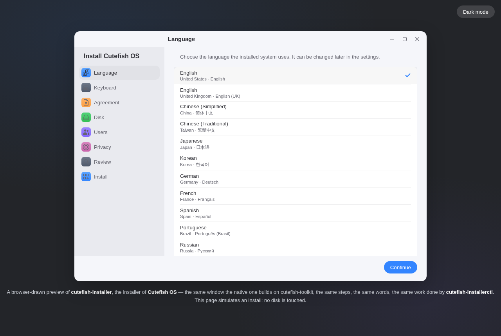 | 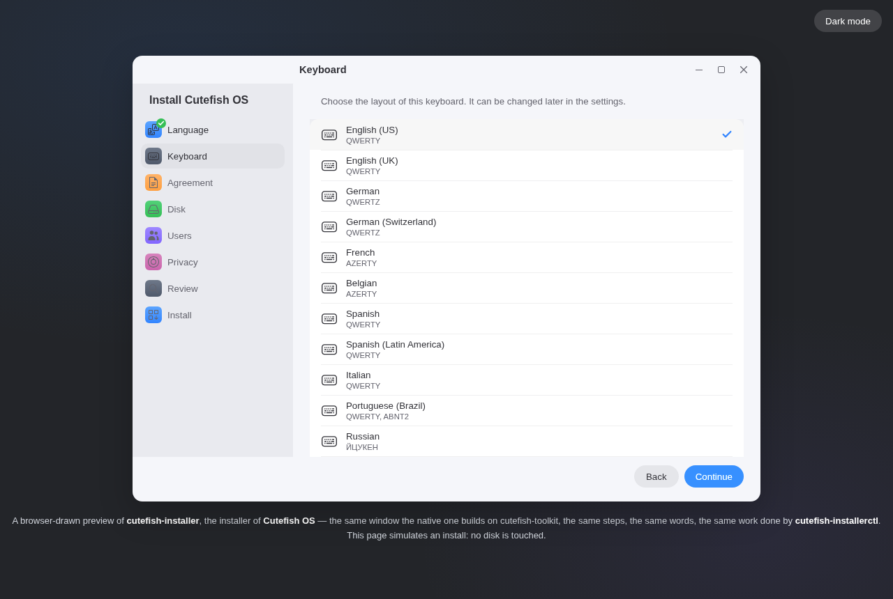 |
| *The language, twenty of them in the table* | *The keyboard, twenty layouts* |
| 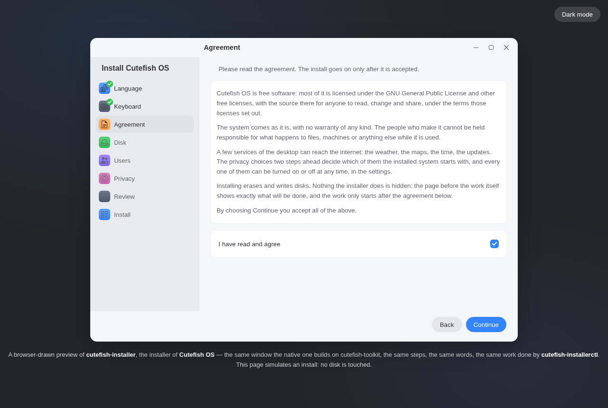 | 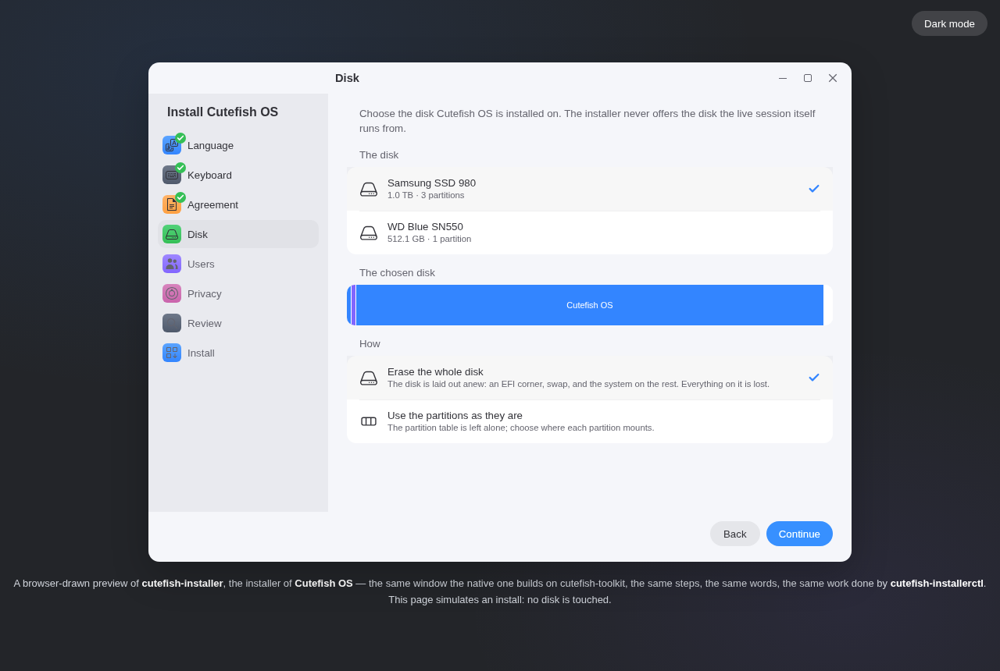 |
| *The agreement, and its own answer* | *The disk, and what the install would do with it* |
| 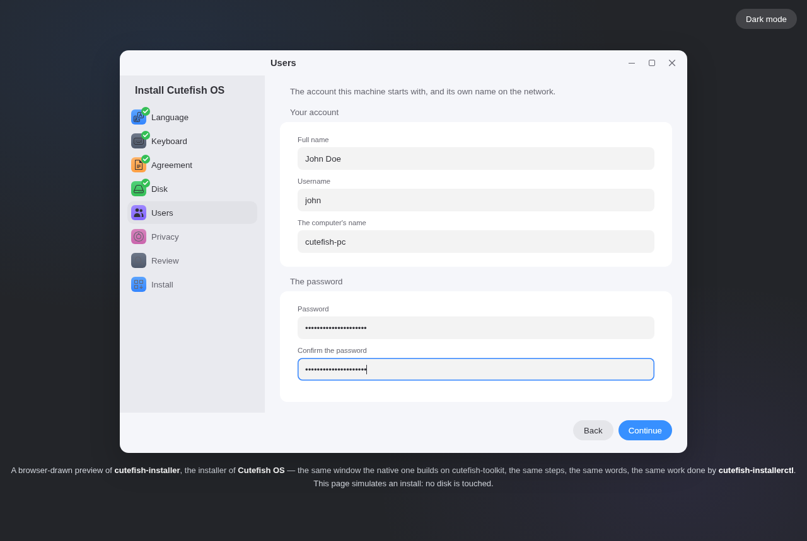 | 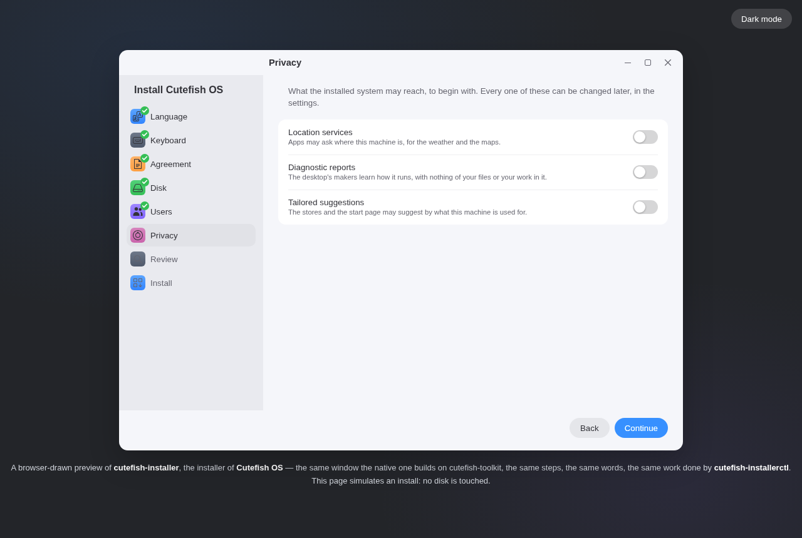 |
| *The account, the password, the zone* | *What the system may reach* |
| 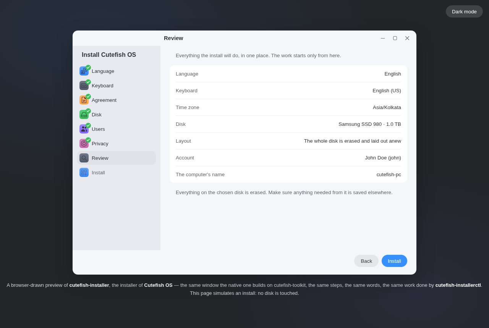 | 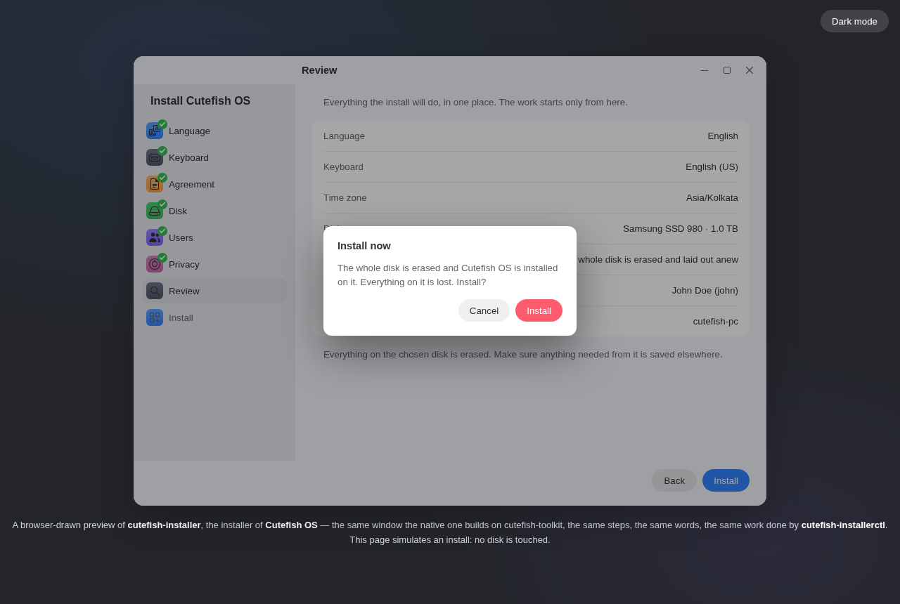 |
| *Everything in one place* | *The warning the red button asks* |
| 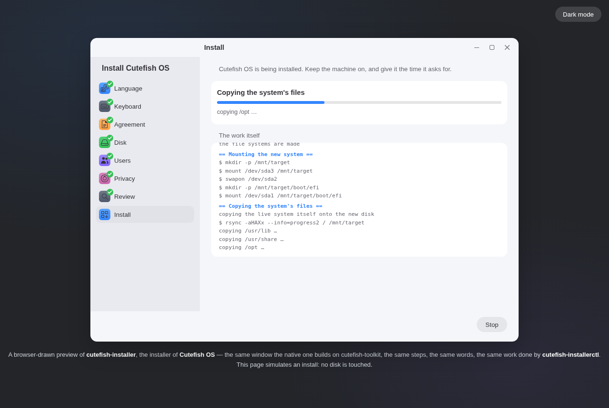 | 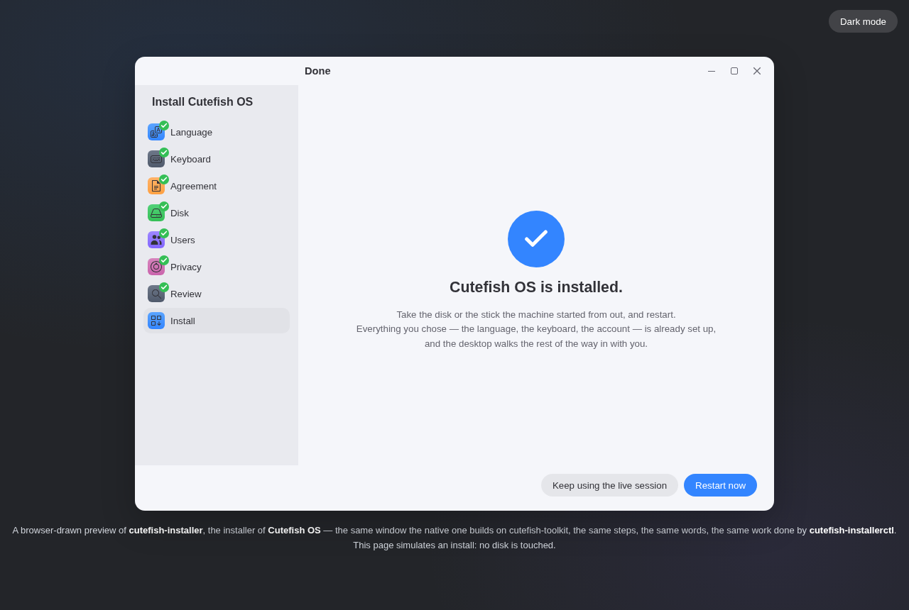 |
| *The work itself, told as it runs* | *The end of the walk* |
| 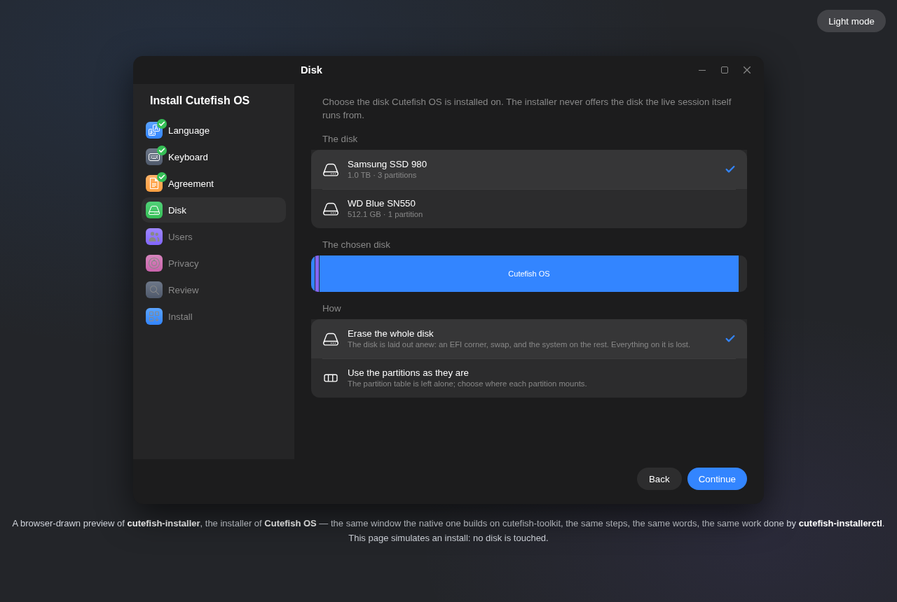 | |
| *The dark theme follows the desktop* | |

The preview itself is one file — `preview/cutefish-installer-demo.html` —
that walks the same steps with the same words as the native window, and
simulates the install. Open it in any browser; it touches no disk.

## The parts

| Program | What it is |
|---|---|
| `cutefish-installer` | The window, on the Cutefish desktop's own UI toolkit |
| `cutefish-installerctl` | The tool itself: install, validate, disks, locales, layouts, zones, reboot, poweroff. Runs anywhere, Cutefish or not |
| `installer-core` | The engine shared by both: the disk scan, the plan and its rules, the layouts the planner lays out, and the walk itself — C++ and POSIX, nothing else |

The window never installs itself. It writes the plan's JSON and starts
`cutefish-installerctl install --progress-events`, reading the events it
prints; on a live session the window already holds the administrator's
own rights, and a window started from a desktop re-execs itself through
`pkexec` before it ever gets there, with the polkit action
`org.cutefish.installer.launch` saying what the password is asked for.
The last step's *Restart now* goes the same way — `reboot` through the
CLI, into the system the engine just built.

```
cutefish-installerctl install  --config plan.json            # what the window runs
cutefish-installerctl install  --config plan.json --dry-run   # every command, none run
cutefish-installerctl validate --config plan.json            # the plan, checked
cutefish-installerctl disks    --json                        # the disks, without the live one
cutefish-installerctl locales | layouts | zones              # the pages' own tables
cutefish-installerctl reboot | poweroff                      # the end of the walk
```

Exit codes: `0` finished, `1` failed, `2` cancelled. With
`--progress-events`, the run tells itself as `step`, `progress`, `log` and
`finished` events, one JSON object a line on stdout; the words for a
person still go to stderr, where the journal keeps them.

## The plan's JSON

Everything an installation needs, in one object both the window and the
command line write and read:

```json
{
  "version": 1,
  "mode": "erase",
  "device": "/dev/sda",
  "swap": "auto",
  "language": "en_US",
  "keyboard": "us",
  "timezone": "Asia/Kolkata",
  "fullName": "John Doe",
  "username": "john",
  "password": "correct-horse-battery",
  "hostname": "cutefish-pc",
  "privacy": { "location": false, "diagnostics": false, "tailored": false },
  "source": "live",
  "partitions": []
}
```

The `manual` mode carries the chosen partitions instead of the whole-disk
layout — one `{ "path": "/dev/sda3", "mount": "/", "fs": "ext4",
"format": true }` a partition — and the `source` is the live session
(`live`), a squashfs image, or a plain rootfs directory. The plan is
checked before anything is touched: the device is among the machine's
own disks, the username is one a system takes, the hostname one a network
takes, the manual mode has a root and, on a UEFI machine, a `/boot/efi`.

## Dependencies

The engine needs the C++ library and POSIX alone, and reads the disks
through `lsblk`. The install itself walks the tools every distribution
already has: `wipefs`, `sgdisk` (from gdisk), `partprobe`, `udevadm`,
`mkfs.ext4`, `mkfs.vfat`, `mkswap`, `rsync`, `chroot`, and GRUB for the
bootloader. The window is built on
[cutefish-toolkit](https://github.com/cutefishos/cutefish-toolkit), whose
own dependencies — Wayland, Skia, fontconfig — are the desktop's; see its
README. Started from an installed desktop, the window asks for polkit.
For the tests: nothing more.

Debian/Ubuntu:

```shell
sudo apt install build-essential cmake gettext gdisk e2fsprogs dosfstools rsync grub-efi
```

## Build

Follow
[getting-started](https://github.com/cutefishos/getting-started) to install
cutefish-toolkit first; then:

```shell
cmake -S . -B build -DCMAKE_INSTALL_PREFIX=/usr
cmake --build build
sudo cmake --install build
```

Without cutefish-toolkit on the machine the window is skipped, the
command-line tool and the engine build and install just the same, and
`-DBUILD_GUI=OFF` skips the window on purpose.

### Tests

The engine's own tests are real end to end, and touch no disk: the tables
the pages offer, the username and hostname rules, the disk scan from a
canned `lsblk`, the plan's JSON and its checks, the layouts the planner
lays out for every disk and memory it is asked about, the mounts table it
writes, and the whole installation walked through as a dry run whose
every command is checked, not run — plus the command-line tool itself,
run the way the window runs it.

```shell
cmake -S . -B build -DBUILD_TESTING=ON
cmake --build build
ctest --test-dir build --output-on-failure
```

## Translations

`po/cutefish-installer.pot` holds every string of the window and the CLI.
Add a language by copying the template to `po/<code>.po` and filling it in:

```shell
msginit --no-translator --no-wrap -l de_DE.UTF-8 -i po/cutefish-installer.pot -o po/de.po
```

Keep each `{name}` placeholder as it is; the maintainers' own targets
refresh the template and merge it back:

```shell
cmake --build build --target update-translations
cmake --build build --target check-translations
```

## License

BSD 3-Clause; see [LICENSE](LICENSE). The bundled app icon is the
theme's `system-software-install` plate redrawn for the installer; the
window's own glyphs are the [Cutefish icon
theme](https://github.com/cutefishos/icons)'s, GPL-3.0 there, and the
desktop's own copy ships with it.
